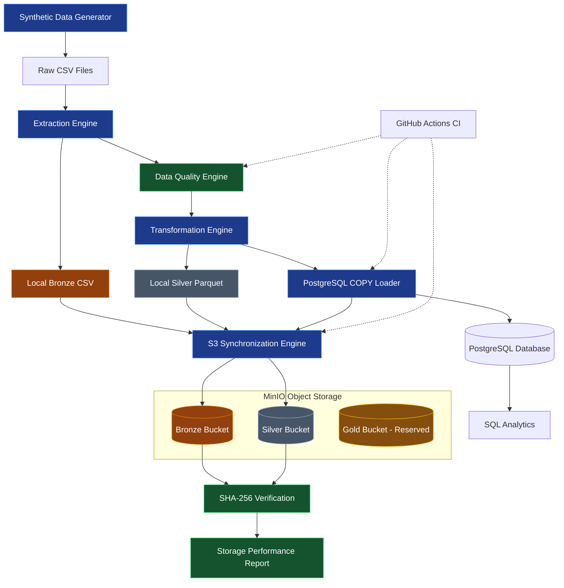
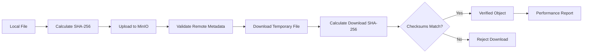
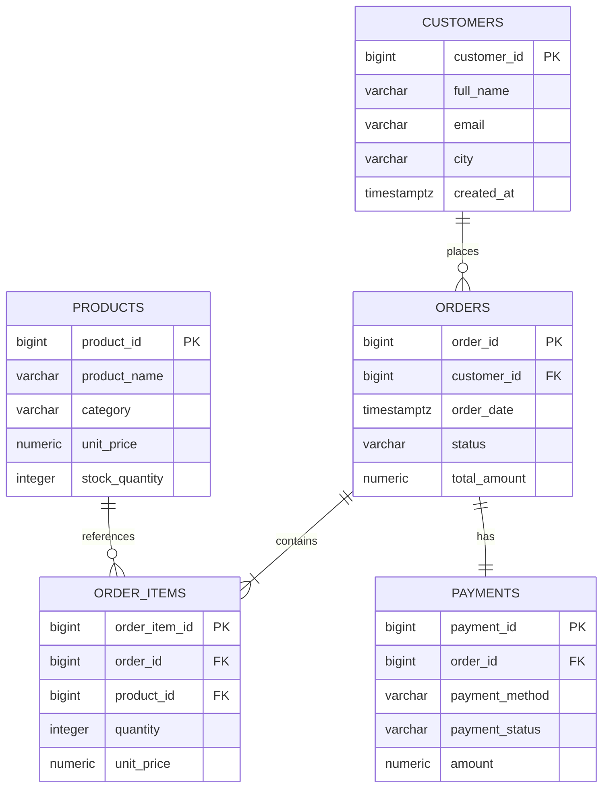
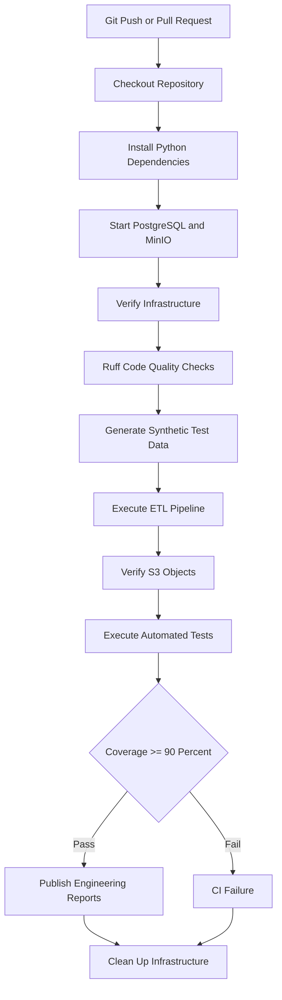

<div align="center">


[](https://github.com/Anuj05Chandrol/dataflow-nexus/actions/workflows/ci.yml)


**A modular end-to-end data engineering platform featuring reproducible data generation, batch ETL, automated data quality, S3-compatible object storage and analytical workloads.**

[Overview](#overview) •
[Architecture](#architecture) •
[Performance](#measured-performance) •
[Quick Start](#quick-start) •
[Testing](#automated-testing) •
[Roadmap](#development-roadmap)

</div>

---

## Overview

DataFlow Nexus is an end-to-end data angineering portfolio
project that simulates a realistic e-commerce data ecosystem.

The platform implements a complete batch ETL pipeline,
relational data validation, columnar storage, PostgreSQL
bulk ingestion and S3-compatible object storage using
MinIO.

The project follows a layered Bronze, Silver and Gold
data lake architecture and incorporates automated testing,
file integrity verification, performance benchmarking
and continuous integration.

DataFlow Nexus is being progressively expanded toward
distributed processing, real-time streaming, workflow
orchestration, analytical warehousing, machine learning
and application development.

## Engineering Highlights

<div align="center">

| Metric | Verified Local Result |
|:---|---:|
| Synthetic Records | **460,775** |
| Relational Tables | **5** |
| Automated Tests | **77 Passed** |
| Core Package Coverage | **93%** |
| Parquet Storage Reduction | **57.14%** |
| S3 Objects Verified | **10/10** |
| File Integrity Verification | **100%** |
| Data Lake Storage Layers | **3** |
| SQL Analytics Queries | **6** |

</div>

## Architecture



## Implemented Features

### Synthetic Data Generation

- Reproducible synthetic e-commerce datasets.
- Configurable workload sizes and random seeds.
- Customer, product, order and payment simulation.
- Seasonal transaction patterns.
- Realistic relational dependencies.
- Configurable transaction statuses and payment methods.

### Batch ETL Pipeline

- Modular extraction, transformation and loading.
- Automated CSV dataset extraction.
- Schema and column validation.
- Typed Apache Parquet datasets.
- Snappy compression.
- PostgreSQL bulk ingestion using COPY.
- Transactional full-refresh database loading.
- Automated ETL performance reporting.

### Data Quality and Validation

- Primary key uniqueness validation.
- Foreign key relationship validation.
- Missing and blank value detection.
- Integer and financial data validation.
- Timestamp validation.
- Order and payment status validation.
- Financial transaction reconciliation.
- Order-item total reconciliation.
- Payment amount reconciliation.

### S3-Compatible Object Storage

- Docker-based MinIO infrastructure.
- Persistent object storage volumes.
- Automated Bronze, Silver and Gold bucket initialization.
- Boto3-based S3 client.
- Automated file upload and download engine.
- SHA-256 file integrity verification.
- Remote object metadata validation.
- Remote object size verification.
- Safe temporary-file downloads.
- Automatic ETL and data lake synchronization.
- Object storage performance reporting.

### Software Engineering

- Modular Python architecture.
- Environment-based configuration.
- Automated unit and integration tests.
- Regression testing.
- Code coverage reporting.
- Ruff linting and formatting.
- Git feature branch workflow.
- GitHub Actions continuous integration.
- Reproducible benchmark documentation.

## Data Lake Architecture

The platform uses a layered data lake design with
S3-compatible object storage.

| Layer | Bucket | Format | Purpose | Status |
|---|---|---|---|---|
| Bronze | `nexus-bronze` | CSV | Original raw datasets | Implemented |
| Silver | `nexus-silver` | Parquet | Cleaned and validated datasets | Implemented |
| Gold | `nexus-gold` | Planned | Business-ready analytical datasets | Reserved |

### Object Storage Structure

```text
MinIO Object Storage
│
├── nexus-bronze/
│   ├── customers.csv
│   ├── products.csv
│   ├── orders.csv
│   ├── order_items.csv
│   └── payments.csv
│
├── nexus-silver/
│   ├── customers.parquet
│   ├── products.parquet
│   ├── orders.parquet
│   ├── order_items.parquet
│   └── payments.parquet
│
└── nexus-gold/
    └── Reserved for future analytical datasets
```

### File Integrity Workflow



Every synchronized object is independently downloaded
and verified against its original SHA-256 checksum.

Failed downloads are rejected without replacing existing
valid destination files.

## Measured Performance

### Batch ETL Benchmark

Local benchmark recorded on November 25, 2026,
before the object storage integration.

| Metric | Result |
|---|---:|
| Total generated records | 460,775 |
| Synthetic generation time | 1.58 seconds |
| Generation throughput | 290,750 records/sec |
| Batch ETL execution time | 24.642 seconds |
| Batch ETL throughput | 18,699 records/sec |
| Raw CSV size | 16.54 MiB |
| Parquet size | 7.09 MiB |
| Storage reduction | 57.14% |
| PostgreSQL database size | 63 MB |
| Baseline automated tests | 38 passed |

### Object Storage Benchmark

Local benchmark recorded on November 26, 2026.

| Metric | Result |
|---|---:|
| Underlying synthetic records | 460,775 |
| Bronze CSV objects | 5 |
| Silver Parquet objects | 5 |
| Total uploaded objects | 10 |
| SHA-256 verified objects | 10/10 |
| File integrity verification | 100% |
| Bronze storage | 16.54 MiB |
| Silver storage | 7.09 MiB |
| Total object storage | 23.6251 MiB |
| Bronze synchronization time | 21.4012 seconds |
| Silver synchronization time | 21.0461 seconds |
| Total synchronization time | 44.6597 seconds |

Synchronization time includes uploading, downloading
and independently verifying all ten objects.

The original batch ETL benchmark does not include
object storage synchronization.

### Dataset Storage Comparison

| Dataset | CSV Size | Parquet Size | Reduction |
|---|---:|---:|---:|
| Customers | 782,285 B | 255,531 B | 67.34% |
| Products | 49,782 B | 25,691 B | 48.39% |
| Orders | 5,605,579 B | 2,446,783 B | 56.35% |
| Order Items | 6,809,202 B | 2,820,303 B | 58.58% |
| Payments | 4,093,257 B | 1,884,311 B | 53.96% |
| **Total** | **17,340,105 B** | **7,432,619 B** | **57.14%** |

### Benchmark Environment

| Component | Configuration |
|---|---|
| Processor | Intel Core i7-12700H |
| System Memory | 16 GB RAM |
| Operating System | Windows with WSL2 |
| Container Runtime | Docker Desktop |
| Python | 3.11 |
| Database | PostgreSQL 16 |
| Object Storage | MinIO |
| Processing Engine | Pandas |
| Columnar Format | Apache Parquet |

### Benchmark Evidence

- [Batch ETL Benchmark](docs/benchmarks/batch_etl_460775.json)
- [MinIO Object Storage Benchmark](docs/benchmarks/minio_storage_460775.json)

All results represent measured local synthetic-data
benchmarks, not distributed production workloads.

## Technology Stack

| Layer | Technology |
|---|---|
| Programming | Python, SQL |
| Data Generation | Faker |
| Data Processing | Pandas, NumPy |
| Columnar Storage | Apache Parquet, PyArrow |
| Compression | Snappy |
| Database | PostgreSQL |
| Database Connectivity | SQLAlchemy, Psycopg |
| Object Storage | MinIO |
| S3 SDK | Boto3, Botocore |
| Data Integrity | SHA-256 |
| Data Lake Architecture | Bronze, Silver, Gold |
| Infrastructure | Docker, Docker Compose |
| Environment Configuration | python-dotenv |
| Testing | Pytest, pytest-cov |
| Code Quality | Ruff |
| Version Control | Git, GitHub |
| Continuous Integration | GitHub Actions |

## Dataset

All data is synthetically generated.

| Entity | Records |
|---|---:|
| Customers | 10,000 |
| Products | 1,000 |
| Orders | 100,000 |
| Order Items | 249,775 |
| Payments | 100,000 |
| **Total** | **460,775** |

The dataset includes synthetic Indian cities,
product categories, order statuses, payment methods
and seasonal transaction patterns.

### Relational Data Model



The synthetic data generator produces one payment
record per order, enforced by pipeline validation.

## SQL Analytics

The PostgreSQL database supports analytical SQL
queries for synthetic business workloads.

| Analysis | Description |
|---|---|
| Revenue Analysis | Completed orders, revenue and average order value |
| City Performance | Top-performing customer cities |
| Category Performance | Product category sales and revenue |
| Monthly Sales | Monthly transaction and revenue trends |
| Payment Distribution | Payment method usage and distribution |
| Database Storage | PostgreSQL storage consumption |

SQL queries are available in
[`warehouse/queries/`](warehouse/queries/).

## Automated Testing

### Latest Verified Local Results

| Metric | Result |
|---|---:|
| Total automated tests | 77 |
| Passing tests | 77 |
| Failed tests | 0 |
| Test pass rate | 100% |
| Object storage unit tests | 19 |
| MinIO integration tests | 8 |
| Core package statement coverage | 93% |
| Measured statements | 440 |
| Uncovered statements | 32 |
| Complete test execution time | 57.04 seconds |

### Module Coverage

| Module | Coverage |
|---|---:|
| Synthetic Data Generator | 100% |
| Object Storage Configuration | 100% |
| Parquet Transformer | 100% |
| SHA-256 Integrity Engine | 100% |
| S3 Upload Engine | 100% |
| S3 Download Engine | 94% |
| Generator Configuration | 94% |
| Data Quality Engine | 91% |
| CSV Extraction Engine | 88% |
| PostgreSQL Loader | 88% |
| Bucket Management | 88% |
| Database Configuration | 70% |
| S3 Client | 58% |
| **Overall Core Package Coverage** | **93%** |

Coverage is measured across the `ingestion`,
`processing`, `configs` and `storage` packages.

The test suite includes:

- Synthetic data generation tests.
- Database connectivity tests.
- Primary and foreign key validation tests.
- Financial reconciliation tests.
- Parquet transformation tests.
- PostgreSQL bulk loader tests.
- Object storage configuration tests.
- SHA-256 checksum tests.
- Upload and download tests.
- Corruption detection tests.
- Bucket initialization tests.
- Real MinIO integration tests.
- Regression tests.

## Continuous Integration

The GitHub Actions workflow is configured to validate
the platform in an isolated Linux runner environment.



The updated workflow includes:

- Automated dependency installation.
- PostgreSQL and MinIO infrastructure startup.
- Infrastructure readiness checks.
- Automated bucket initialization.
- Synthetic test dataset generation.
- Complete ETL execution.
- Object storage integrity verification.
- Automated regression testing.
- Minimum 90% core package coverage requirement.
- Downloadable coverage and benchmark reports.
- Automatic temporary infrastructure cleanup.

[View GitHub Actions](https://github.com/Anuj05Chandrol/dataflow-nexus/actions)

## Quick Start

### Prerequisites

- Python 3.11
- Docker with Docker Compose
- Git
- Sufficient local disk space and memory

### 1. Clone Repository

```bash
git clone https://github.com/Anuj05Chandrol/dataflow-nexus.git
cd dataflow-nexus
```

### 2. Create Virtual Environment

Windows PowerShell:

```powershell
python -m venv .venv
.\.venv\Scripts\Activate.ps1
```

Linux/macOS:

```bash
python3 -m venv .venv
source .venv/bin/activate
```

### 3. Install Dependencies

```bash
python -m pip install --upgrade pip
python -m pip install -r requirements.txt
python -m pip check
```

### 4. Configure Environment

Windows PowerShell:

```powershell
Copy-Item .env.example .env
```

Linux/macOS:

```bash
cp .env.example .env
```

Configure unique PostgreSQL and MinIO passwords
inside the `.env` file.

Required configuration includes:

```dotenv
POSTGRES_USER=nexus_admin
POSTGRES_PASSWORD=replace_with_local_password
POSTGRES_DB=dataflow_nexus
POSTGRES_HOST=localhost
POSTGRES_PORT=5433

MINIO_ENDPOINT=http://localhost:9000
MINIO_ROOT_USER=nexus_storage_admin
MINIO_ROOT_PASSWORD=replace_with_unique_storage_password
MINIO_API_PORT=9000
MINIO_CONSOLE_PORT=9001
MINIO_REGION=us-east-1

MINIO_BRONZE_BUCKET=nexus-bronze
MINIO_SILVER_BUCKET=nexus-silver
MINIO_GOLD_BUCKET=nexus-gold

DATA_RECORDS=100000
RANDOM_SEED=42
```

Never commit the actual `.env` file or real credentials.

### 5. Start Infrastructure

```bash
docker compose config --quiet
docker compose up -d --wait
docker compose ps
```

### Infrastructure Endpoints

| Service | Endpoint |
|---|---|
| PostgreSQL | localhost:5433 |
| MinIO S3 API | http://localhost:9000 |
| MinIO Web Console | http://localhost:9001 |

### 6. Verify PostgreSQL

```bash
python -m scripts.check_database
```

### 7. Initialize Object Storage

```bash
python -m scripts.check_object_storage
```

This command creates the required data lake buckets
if they do not already exist.

Open the MinIO console at:

http://localhost:9001

Authenticate using the locally configured MinIO
credentials.

### 8. Generate Synthetic Dataset

```bash
python -m scripts.generate_data --customers 10000 --products 1000 --orders 100000 --seed 42
```

### 9. Execute Complete ETL Pipeline

```bash
python -m scripts.run_etl
```

The pipeline performs extraction, validation,
transformation, PostgreSQL loading and MinIO
object storage synchronization.

The database loader performs a full refresh and is
intended for synthetic development datasets.

### 10. Synchronize Data Lake Independently

```bash
python -m scripts.sync_data_lake
```

This command uploads existing Bronze and Silver
datasets and independently verifies their integrity.

### 11. Run Automated Tests

Run unit tests:

```bash
python -m pytest tests/unit -v
```

Run integration tests:

```bash
python -m pytest tests/integration -v
```

Run the complete test suite:

```bash
python -m pytest -v
```

Integration tests require running infrastructure
and previously generated and loaded synthetic datasets.

### 12. Measure Code Coverage

```bash
python -m pytest --cov=ingestion --cov=processing --cov=configs --cov=storage --cov-report=term-missing --cov-report=html --cov-report=xml
```

The generated HTML report is available at:

```text
htmlcov/index.html
```

### 13. Run Code Quality Checks

```bash
python -m ruff check configs storage ingestion processing scripts tests
```

### 14. Run SQL Analytics

Windows PowerShell:

```powershell
.\scripts\run_analytics.ps1
```

### 15. Stop Infrastructure

```bash
docker compose down
```

Persistent database and object storage volumes
are preserved.

> Warning: `docker compose down -v` deletes persistent
> volumes. Only use it when intentionally resetting
> the development environment.

## Project Structure

```text
dataflow-nexus/
│
├── .github/
│   └── workflows/
│       └── ci.yml
│
├── configs/
│   ├── database.py
│   └── object_storage.py
│
├── ingestion/
│   ├── batch/
│   │   ├── extractor.py
│   │   └── loader.py
│   └── generators/
│       ├── config.py
│       └── ecommerce.py
│
├── processing/
│   ├── transformations/
│   │   └── transformer.py
│   └── validation/
│       └── quality.py
│
├── storage/
│   └── object_store/
│       ├── client.py
│       ├── buckets.py
│       ├── uploader.py
│       ├── downloader.py
│       └── integrity.py
│
├── scripts/
│   ├── generate_data.py
│   ├── check_database.py
│   ├── check_object_storage.py
│   ├── run_etl.py
│   ├── sync_data_lake.py
│   └── run_analytics.ps1
│
├── tests/
│   ├── unit/
│   │   ├── test_generator.py
│   │   ├── test_quality.py
│   │   ├── test_transformer.py
│   │   ├── test_database_config.py
│   │   └── test_object_storage.py
│   └── integration/
│       ├── test_database.py
│       ├── test_etl.py
│       ├── test_loader.py
│       └── test_minio.py
│
├── warehouse/
│   ├── queries/
│   └── schemas/
│
├── docs/
│   └── benchmarks/
│       ├── batch_etl_460775.json
│       └── minio_storage_460775.json
│
├── .env.example
├── .gitignore
├── compose.yaml
├── pyproject.toml
├── requirements.txt
├── LICENSE
└── README.md
```

Generated datasets, local credentials, virtual
environments, runtime reports and temporary
artifacts are intentionally excluded from
version control.

## Runtime Reports

The pipeline generates structured JSON reports
during execution.

| Report | Purpose |
|---|---|
| `logs/etl_report.json` | ETL execution metrics and data quality results |
| `logs/object_storage_report.json` | S3 synchronization and integrity metrics |
| `coverage.xml` | Machine-readable code coverage |
| `htmlcov/index.html` | Interactive HTML coverage report |

## Security and Reliability

The current development implementation includes:

- Environment-based credential management.
- Git exclusion of local secrets.
- Localhost-bound infrastructure endpoints.
- Persistent Docker storage volumes.
- S3 request authentication.
- SHA-256 file integrity verification.
- Remote object metadata validation.
- Temporary-file download protection.
- Transactional PostgreSQL loading.
- Automated data quality validation.
- Dependency compatibility checks.
- Automated regression testing.

The platform is designed for local development
and educational engineering workloads.

Production deployment would require additional
security hardening, least-privilege service accounts,
TLS, monitoring, backups and recovery mechanisms.

## Development Roadmap

| Stage | Engineering Milestone | Status |
|---:|---|---|
| 01 | Development Environment | Complete |
| 02 | Repository Foundation | Complete |
| 03 | PostgreSQL Infrastructure | Complete |
| 04 | Synthetic Data Generation | Complete |
| 05 | Batch ETL Pipeline | Complete |
| 06 | Automated Testing and GitHub CI | Complete |
| 07 | MinIO Object Storage | Local Implementation Complete |
| 08 | Apache Spark Distributed Processing | Upcoming |
| 09 | Apache Kafka Streaming | Planned |
| 10 | Apache Airflow Orchestration | Planned |
| 11 | dbt Analytical Warehouse | Planned |
| 12 | Power BI Dashboards | Planned |
| 13 | Machine Learning and MLflow | Planned |
| 14 | FastAPI Backend | Planned |
| 15 | Next.js Frontend | Planned |
| 16 | Prometheus and Grafana Monitoring | Planned |

### Next Milestone: Apache Spark

The next development stage will introduce:

- Apache Spark infrastructure.
- PySpark processing pipelines.
- Spark and MinIO integration.
- Distributed data transformations.
- Partitioned Parquet datasets.
- Spark SQL analytics.
- Pandas versus Spark performance comparisons.
- Million-record workload benchmarks.
- Distributed processing tests.

These are planned capabilities and are not
part of the current implementation.

## Current Limitations

- Single-machine, in-memory batch processing.
- Full-refresh ingestion rather than incremental loading.
- Synthetic datasets rather than production data.
- Local staging files are retained before S3 synchronization.
- PostgreSQL and MinIO do not share an atomic transaction.
- Object synchronization overwrites existing object keys.
- Object storage verification introduces additional latency.
- Gold analytical datasets are not implemented yet.
- Distributed processing is not implemented yet.
- Real-time streaming is not implemented yet.
- Historical third-party MinIO image used for development.
- Production security and availability hardening are pending.

## Author

<div align="center">

### Anuj Chandrol

**Data Science Engineering Graduate**

Data Engineering • Software Engineering • Machine Learning

[](https://github.com/Anuj05Chandrol)
[](https://linkedin.com/in/anuj-chandrol-79b1a62a7)

</div>

## License

Distributed under the MIT License.

See [LICENSE](LICENSE) for more information.

---

<div align="center">

**DataFlow Nexus**

Building a scalable data engineering platform,
one milestone at a time.


</div>
