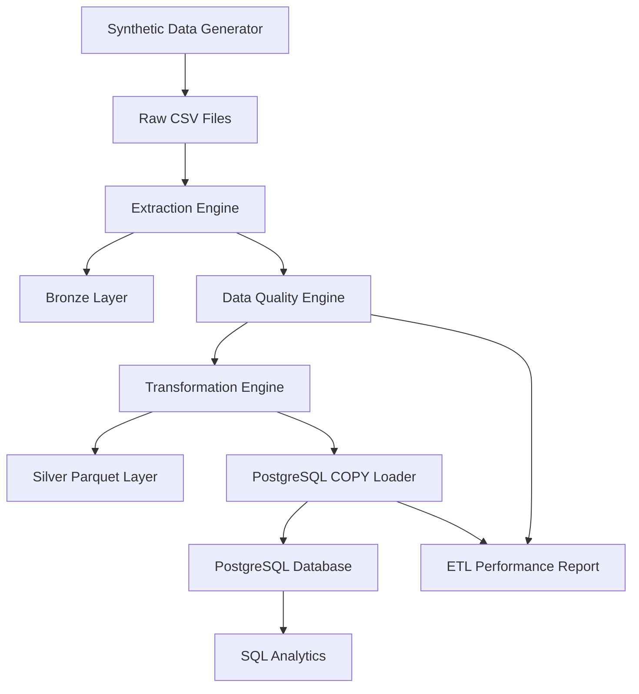

<div align="center">


[](https://github.com/Anuj05Chandrol/dataflow-nexus/actions/workflows/ci.yml)


**A modular data engineering platform for reproducible data generation, batch processing, data quality, columnar storage and analytical workloads.**

</div>

---

## Overview

DataFlow Nexus is an end-to-end data engineering portfolio
project that simulates an e-commerce data ecosystem.

The initial implementation provides a complete batch ETL
pipeline using Python, Pandas, Apache Parquet, PostgreSQL
and Docker.

The platform is being progressively expanded to support
distributed processing, streaming, orchestration,
analytics and machine learning.

## Architecture



## Implemented Features

- Reproducible synthetic e-commerce data generation
- Configurable workload sizes and random seeds
- Relational data integrity validation
- Primary and foreign key validation
- Financial transaction reconciliation
- Typed Apache Parquet datasets
- Snappy compression
- PostgreSQL bulk ingestion using COPY
- Transactional full-refresh loading
- Automated unit and integration tests
- SQL business analytics
- Docker-based database infrastructure
- Automated ETL performance reporting
- GitHub Actions CI workflow

## Measured Performance

Local benchmark recorded on November 25, 2026.

| Metric | Result |
|---|---:|
| Total generated records | 460,775 |
| Synthetic generation time | 1.58 seconds |
| Generation throughput | 290,750 records/sec |
| ETL execution time | 24.642 seconds |
| ETL throughput | 18,699 records/sec |
| Raw CSV size | 16.54 MiB |
| Parquet size | 7.09 MiB |
| Storage reduction | 57.14% |
| PostgreSQL database size | 63 MB |
| Baseline automated tests | 38 passed |

### Benchmark Environment

- Intel Core i7-12700H
- 16 GB RAM
- Windows with WSL2
- Docker Desktop
- Python 3.11
- PostgreSQL 16

Results represent a local development benchmark,
not a distributed production workload.

## Technology Stack

| Layer | Technology |
|---|---|
| Programming | Python, SQL |
| Data Generation | Faker |
| Data Processing | Pandas |
| Columnar Storage | Apache Parquet, PyArrow |
| Database | PostgreSQL |
| Database Connectivity | SQLAlchemy, Psycopg |
| Infrastructure | Docker, Docker Compose |
| Testing | Pytest, pytest-cov |
| Code Quality | Ruff |
| CI | GitHub Actions |

## Dataset

All data is synthetically generated.

| Entity | Records |
|---|---:|
| Customers | 10,000 |
| Products | 1,000 |
| Orders | 100,000 |
| Order Items | 249,775 |
| Payments | 100,000 |
| Total | 460,775 |

The dataset includes synthetic Indian cities,
product categories, order statuses, payment methods
and seasonal transaction patterns.

## Quick Start

### Prerequisites

- Python 3.11
- Docker with Docker Compose
- Git

### Clone Repository

```bash
git clone https://github.com/Anuj05Chandrol/dataflow-nexus.git
cd dataflow-nexus
```

### Create Virtual Environment

Windows PowerShell:

```powershell
python -m venv .venv
.\.venv\Scripts\Activate.ps1
```

Linux/macOS:

```bash
python3 -m venv .venv
source .venv/bin/activate
```

### Install Dependencies

```bash
python -m pip install -r requirements.txt
```

### Configure Environment

Copy `.env.example` to `.env` and configure
the PostgreSQL password before starting the database.

Never commit the `.env` file.

### Start Infrastructure

```bash
docker compose up -d --wait
```

### Generate Dataset

```bash
python -m scripts.generate_data --customers 10000 --products 1000 --orders 100000 --seed 42
```

### Execute ETL

```bash
python -m scripts.run_etl
```

### Run Automated Tests

```bash
python -m pytest -v
```

### Measure Code Coverage

```bash
python -m pytest --cov=ingestion --cov=processing --cov=configs --cov-report=term-missing
```

### Run SQL Analytics

Windows PowerShell:

```powershell
.\scripts\run_analytics.ps1
```

## Project Structure

```text
dataflow-nexus/
├── .github/workflows/
├── configs/
├── ingestion/
│   ├── batch/
│   └── generators/
├── processing/
│   ├── transformations/
│   └── validation/
├── scripts/
├── tests/
│   ├── unit/
│   └── integration/
├── warehouse/
│   ├── queries/
│   └── schemas/
├── compose.yaml
├── pyproject.toml
├── requirements.txt
├── LICENSE
└── README.md
```

Generated datasets, local credentials and runtime
artifacts are intentionally excluded from version control.

## Development Roadmap

- [x] Development environment
- [x] PostgreSQL infrastructure
- [x] Synthetic data generation
- [x] Batch ETL pipeline
- [x] Data quality validation
- [x] Parquet storage
- [x] SQL analytics
- [ ] MinIO object storage
- [ ] Apache Spark distributed processing
- [ ] Apache Kafka streaming
- [ ] Apache Airflow orchestration
- [ ] dbt analytical warehouse
- [ ] Power BI dashboards
- [ ] Machine learning and MLflow
- [ ] FastAPI backend
- [ ] Next.js frontend
- [ ] Prometheus and Grafana monitoring

## Current Limitations

- Single-machine, in-memory batch processing
- Full-refresh ingestion rather than incremental loading
- Synthetic data rather than production data
- Local filesystem-based data lake
- No distributed processing or real-time streaming yet

## Author

**Anuj Chandrol**

Data Science Engineering Graduate

- GitHub: https://github.com/Anuj05Chandrol
- LinkedIn: https://linkedin.com/in/anuj-chandrol-79b1a62a7

## License

Distributed under the MIT License.

<div align="center">


</div>
